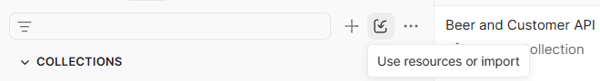
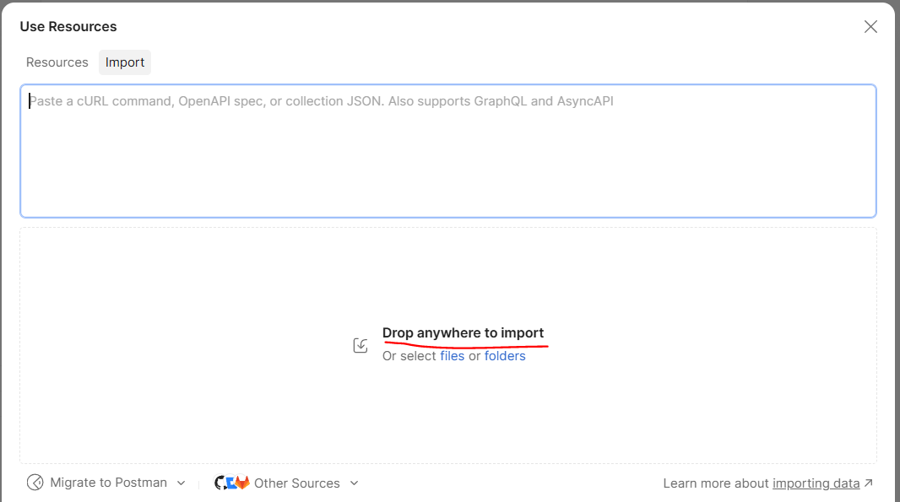
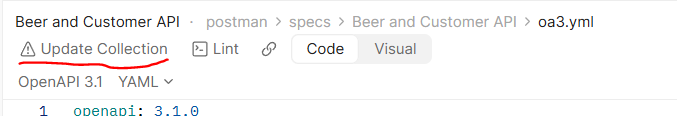
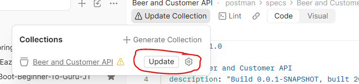
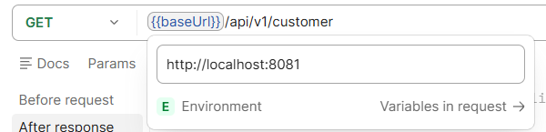
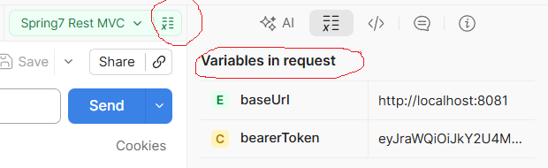
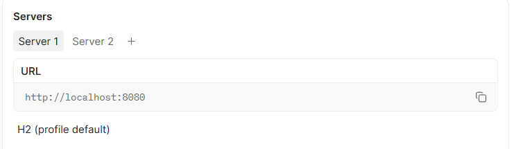
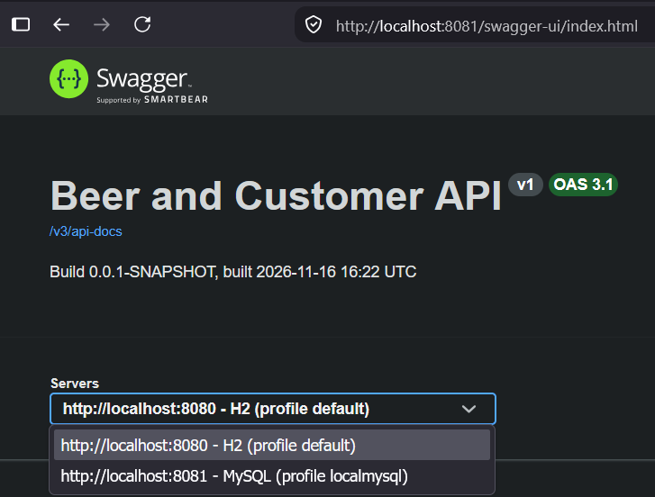
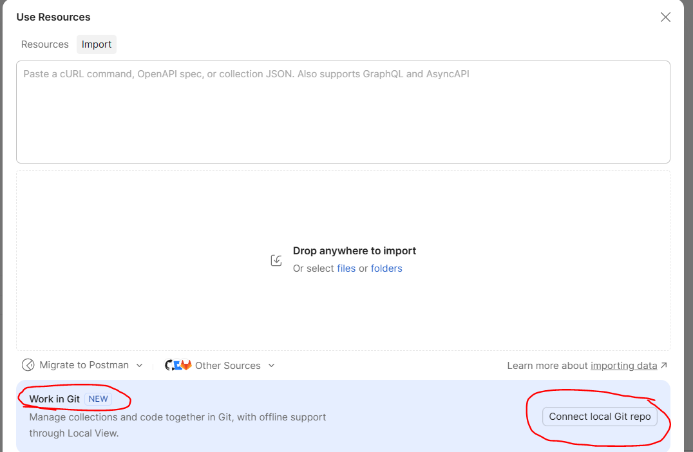

# Postman : du contrat généré à la collection, rangée dans Git

> Issue #56. Code : branche `128-springdoc-maven-plugin-jt-sb412-postman` (commits `0276b8ad` et `7b6be5ee`).
> Application : Postman 12.36.4 sur Windows (voir les infos système pour plus de détails), workspace « My Workspace ».

## 1. Le chemin

**Le but :** utiliser dans Postman le contrat OpenAPI que le build génère, au lieu d'écrire les requêtes à la main,
puis ranger dans le dépôt Git ce qu'on a construit dans Postman.

```
 Mon disque                  Application Postman                         Dépôt Git (dossier postman/)
 ----------                  -------------------                         ----------------------------
 ./mvnw verify
      |
      v
 target/oa3.yml --import-->  spec "Beer and Customer API"   ---copie--->  specs/Beer and Customer API/oa3.yml
 (le contrat)                (le contrat dans Postman)
                                   |
                                génère
                                   v
                             collection "Beer and Customer API" --CLI-->  collections/Beer and Customer API/
                             (les requêtes, baseUrl, script)              (un fichier YAML par élément)
```

| Élément | Où il vit | Qui le crée |
|---|---|---|
| `target/oa3.yml` | mon disque | le build `./mvnw verify` (Chap376) |
| la spec | Postman, panneau SPECS | moi, en important `target/oa3.yml` |
| la collection | Postman, panneau COLLECTIONS | Postman la génère depuis la spec ; moi, j'y ajoute `baseUrl` et le script du jeton |
| les deux copies dans Git | dossier `postman/` du dépôt | Claude : la spec est copiée telle quelle, la collection est récupérée avec le Postman CLI |

**Rien n'est automatique :** chaque flèche du schéma est une action faite à la main. L'automatiser : issue #58.

## 2. Build et import

**Générer le contrat :** `./mvnw verify` écrit `target/oa3.yml`. Si un test est rouge exprès (pendant un essai),
`./mvnw verify -DskipTests` le génère quand même : la génération dépend de `skipITs`, pas de `skipTests`.

**L'importer :**

1. En haut du panneau de gauche, cliquer sur l'icône d'import, à droite du `+` (info-bulle « Use resources or import ») :

   

2. La fenêtre « Use Resources » s'ouvre sur l'onglet **Import**. Glisser `target/oa3.yml` dans la zone
   « Drop anywhere to import » (ou cliquer sur « files » pour le choisir) :

   

L'import crée **deux** choses :
- la **spec**, dans SPECS > specs > Beer and Customer API > `oa3.yml`, marqué `ROOT` (le fichier principal).
  Elle a deux vues, **Code** (le YAML, modifiable) et **Visual** (un formulaire) ;
- la **collection** « Beer and Customer API », générée depuis la spec, dans COLLECTIONS.

**Après un nouveau build :** la spec de Postman est une **copie**, elle ne relit pas `target/oa3.yml`. Il faut :

1. dans IntelliJ, copier tout `target/oa3.yml` ; dans Postman, vue **Code** de la spec : `Ctrl+A`, `Ctrl+V` ;
2. cliquer sur **Update Collection**, en haut de la spec :

   

3. un popup « Collections » s'ouvre :

   

| Ce qu'on voit | Ce que ça veut dire |
|---|---|
| ⚠ (triangle jaune) à droite du nom de la collection | info-bulle « Collection not up to date with the spec » |
| bouton **Update** | met la collection à jour depuis la spec ; ensuite ✓ (coche verte) à la place du ⚠, et le bouton est grisé |
| ⚙ (roue dentée) à droite de **Update** | « Configure Update Settings » : deux réglages, tous deux désactivés, « Sync example values between Spec and Collection » et « Remove orphan requests » |
| **+ Generate Collection** (en haut du popup) | génère une **nouvelle** collection depuis la spec |

**Ce que fait Update (vérifié le 16-11-2026) :** il garde `baseUrl`, le script du jeton et le jeton, et il recopie la
description du contrat (`info.description`, l'heure du build) dans la collection.

## 3. La collection : `baseUrl`, le jeton, l'environnement

**Ce que j'ai ajouté à la main à la collection générée :**

| Où (dans la collection) | Quoi | Rôle |
|---|---|---|
| onglet **Variables** | `baseUrl` = `http://localhost:8080` | l'adresse par défaut (H2) ; toutes les requêtes commencent par `{{baseUrl}}` |
| onglet **Scripts**, « Before request » | le script du jeton (repris de Chap357) | avant chaque requête, demande un jeton au serveur d'autorisation (port 9000, client credentials) et le garde dans `bearerToken` jusqu'à son expiration (`bearerTokenExpiresAt`) |
| onglet **Authorization** | Bearer `{{bearerToken}}` | envoie le jeton ; déjà présent après la génération depuis la spec |

**L'environnement du projet « Spring7 Rest MVC »** contient les secrets que lit le script (`oidcClientId`,
`clientSecret`) et, si besoin, un `baseUrl`.

**Qui gagne ?** Quand `baseUrl` existe dans l'environnement **actif** et dans la collection, **l'environnement gagne**
(vérifié le 16-11-2026 : environnement 8081, collection 8080, la requête part sur 8081). Donc :
- **8081** (MySQL, profil `localmysql`) : `baseUrl = http://localhost:8081` dans l'environnement ;
- **8080** (H2) : supprimer `baseUrl` de l'environnement, la collection reprend la main.

Un seul environnement par projet suffit : les secrets n'y sont écrits qu'une fois.

**Vérifier sans rien envoyer :**

- survoler `{{baseUrl}}` dans l'adresse de la requête : Postman affiche la valeur qu'il **utilisera** et d'où elle vient
  (**E** = Environment) :

  

- cliquer sur l'icône à droite du sélecteur d'environnement (en haut), puis sur la requête voulue dans COLLECTIONS :
  le panneau « Variables in request » liste ses variables avec leur origine, **E** (environnement) ou **C** (collection) :

  

**Résultat :** `GET list All Customers` → `200` sur 8080 et sur 8081, avec le serveur d'autorisation démarré sur 9000.

## 4. Plusieurs serveurs dans le contrat

**La question de #56 :** pour choisir le port (8080 ou 8081), faut-il déclarer plusieurs serveurs dans le contrat,
ou utiliser les environnements de Postman ?

**L'essai :** dans `OpenApiConfig` (commit `0276b8ad`), la liste `servers` déclare les deux ports :

```java
servers = {
        @Server(url = "http://localhost:8080", description = "H2 (profile default)"),
        @Server(url = "http://localhost:8081", description = "MySQL (profile localmysql)")
})
```

Ce qui donne dans `target/oa3.yml` :

```yaml
servers:
- url: http://localhost:8080
  description: H2 (profile default)
- url: http://localhost:8081
  description: MySQL (profile localmysql)
```

**Ce que fait Postman :** la vue **Visual** de la spec montre un onglet par serveur, *Server 1* et *Server 2* :



Ces onglets **ne font qu'afficher** le contrat : ils ne sont **pas reliés** à `baseUrl`. Vérifié le 16-11-2026 :
`baseUrl` mis à `http://localhost:8999`, clic sur *Server 1* puis *Server 2*, `baseUrl` reste à 8999. La collection
n'a qu'**un** `baseUrl` ; il n'y a pas de liste déroulante pour choisir le serveur.

**La décision :**
- les deux `@Server` **restent** dans `OpenApiConfig`, pour la liste déroulante « Servers » de **Swagger UI**
  (vue le 16-11-2026 sur `http://localhost:8081/swagger-ui/index.html`) :

  

- dans **Postman**, le port se choisit avec l'environnement du projet (section 3).

**Piège dans Swagger UI :** la liste propose d'abord le **premier** serveur (8080), même quand la page est ouverte sur
8081. Avant « Try it out », choisir le serveur de l'application qui tourne, sinon la requête part vers 8080.

**Seul le serveur de la page marche** (essayé le 16-11-2026, `GET /api/v1/beer` avec un jeton) :

| Page Swagger UI ouverte sur | Serveur choisi dans la liste | Résultat |
|---|---|---|
| `http://localhost:8081/swagger-ui/index.html` | 8081 | `200` |
| `http://localhost:8080/swagger-ui/index.html` | 8080 | `200` |
| `http://localhost:8081/swagger-ui/index.html` | 8080 | `TypeError: NetworkError when attempting to fetch resource.` |

**Pourquoi la dernière ligne échoue :** pour le navigateur, un autre port est un autre site (une autre *origine*).
Avant d'envoyer la requête, il demande la permission au serveur 8080 (requête `OPTIONS`, dite *preflight* CORS) ;
l'API ne configure pas CORS et répond `401`, donc le navigateur bloque. L'API elle-même marche : la même requête
envoyée par `curl` répond `200`. Pour appeler un autre port depuis Swagger UI, il faudrait configurer CORS dans l'API.

**Où lire la vraie réponse :** sous « Server response ». La partie « Responses » plus bas (`200 OK`, Example Value)
est la **documentation** du contrat et s'affiche toujours, même quand l'appel a échoué.

**Piste pour plus tard :** une *variable de serveur* OpenAPI (`url: '{baseUrl}'`, valeurs permises 8080 et 8081),
idée de l'IA de Postman : issue #57.

## 5. Dans Git

**Le but :** Git devient la **référence** de la spec et de la collection ; l'application Postman est l'endroit où on
les **travaille**. Commit `7b6be5ee` (33 fichiers, branche `128-springdoc-maven-plugin-jt-sb412-postman`).

**Comment les copies ont été faites (par Claude) :**

| Quoi | Comment |
|---|---|
| la spec | `target/oa3.yml` copié tel quel dans `postman/specs/Beer and Customer API/oa3.yml` |
| la collection | `postman collection get <id> --json` (le Postman CLI lit la collection de mon compte), puis un script Python la découpe en fichiers YAML, comme pour #39 ; vérifiée avec `postman collection lint` (0 erreur) |

**Ce qu'on trouve dans le dépôt :**

```
postman/
├── specs/Beer and Customer API/oa3.yml                <- le contrat
├── collections/Beer and Customer API/
│   ├── .resources/definition.yaml                     <- la collection : baseUrl, auth Bearer, script du jeton
│   └── api/v1/customer/
│       ├── .resources/definition.yaml                 <- le dossier "customer"
│       ├── list All Customers.request.yaml            <- une requête
│       ├── .resources/list All Customers.resources/
│       │   └── examples/OK.example.yaml               <- sa réponse d'exemple (inventée par Postman)
│       └── {customerId}/...                           <- même principe ; et api/v1/beer/... pareil
└── environments/
    ├── local-example.environment.yaml                 <- modèle du fichier des secrets, dans Git (baseUrl ajouté)
    └── local.environment.yaml                         <- mes vraies valeurs, IGNORÉ par Git
```

| Fichier | Nombre | Rôle |
|---|---|---|
| `*.request.yaml` | 12 | une requête (6 pour customer, 6 pour beer) |
| `*.example.yaml` | 12 | une réponse d'exemple par requête |
| `.resources/definition.yaml` | 7 | les réglages d'un dossier ou de la collection. **Nom imposé par le format** : Postman le cherche sous ce nom exact dans chaque dossier |

**Pas de secret dans Git :** `bearerToken` est vide (le script le remplit), et le script lit `oidcClientId` et
`clientSecret` dans l'environnement (`pm.variables.get(...)`).

**Pour la suite :**
- **utiliser** la collection du dépôt (la lancer avec le Postman CLI, la ramener dans l'application, y revenir après
  une modification) : issue #59 ;
- **éviter la copie à la main** : l'application Postman propose « Work in Git » / « Connect local Git repo »
  (fenêtre d'import, en bas), qui relie Postman au dossier du dépôt. Essayé et adopté dans #59
  (la « vue Local Git ») ; reste #58 : mettre à jour la spec sans copie à la main.

  

## Infos système

| | |
|---|---|
| Système | Windows 10 Enterprise (10.0.19045) |
| Postman (application) | 12.36.4 |
| Postman CLI | 1.86.0 (la 1.90.0 est disponible) |
| Java / Spring Boot | JDK 25, Spring Boot 4.1.2, springdoc-openapi 3.2.0 |
