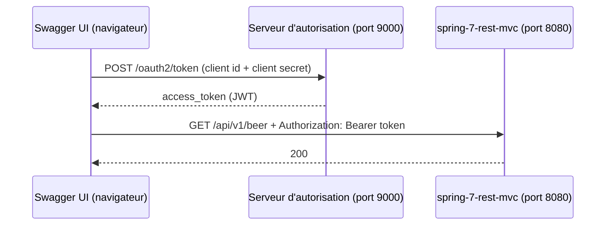

# Section 40 : OpenAPI avec springdoc, ce que nous avons amélioré

**Section / Chapitres :** Sec40_Chap374 à Sec40_Chap376 · **Branches :** voir le tableau ci-dessous

**Contexte :** la Section 40 du cours de John Thompson (JT) documente l'API REST du projet avec **OpenAPI**,
un format standard qui décrit une API (ses URLs, ses champs, sa sécurité). La bibliothèque **springdoc** produit
cette description à partir des controllers, et **Swagger UI**, une page web, permet de l'essayer. Ce document dit
ce que nous avons fait **mieux que JT**, puis ce que nous avons **ajouté**. C'est une photo de la fin de la
section : il n'est jamais mis à jour.

## Les branches

| Branche | Chapitre | Dernier commit |
|---|---|---|
| `126-springdoc-maven-jt-sb412` | Chap374 | [`b9f4f374`](https://github.com/PierreSQS/spring-7-rest-mvc/commit/b9f4f374) (04-11-2026) |
| `127-springdoc-security-cfg-jt-sb412` | Chap375 | [`7f8b6132`](https://github.com/PierreSQS/spring-7-rest-mvc/commit/7f8b6132) (10-11-2026) |
| `127-springdoc-security-cfg-jt-sb412-postman` | Chap375, début de la piste Postman (#39) | [`e6346099`](https://github.com/PierreSQS/spring-7-rest-mvc/commit/e6346099) (05-11-2026) |
| `128-springdoc-maven-plugin-jt-sb412` | Chap376 | [`852e8c41`](https://github.com/PierreSQS/spring-7-rest-mvc/commit/852e8c41) (20-11-2026) |
| `128-springdoc-maven-plugin-jt-sb412-postman` | Chap376, piste Postman | [`3e0dfd0c`](https://github.com/PierreSQS/spring-7-rest-mvc/commit/3e0dfd0c) (22-11-2026) |

Section terminée le 26-11-2026. Les branches 126, 127 et 128 sont gelées : plus aucun commit.
`128-springdoc-maven-plugin-jt-sb412-postman` reste, pour l'instant, la branche de référence des essais Postman ;
`3e0dfd0c` est le dernier commit de cette branche à la fin de la Section 40.

## Les 3 leçons de JT

### Chap374 : springdoc arrive dans le projet

Branche de JT : `126-springdoc-maven`. JT ajoute deux dépendances dans `pom.xml`. springdoc lit les controllers au
démarrage et publie la description de l'API sur `/v3/api-docs`, ainsi que Swagger UI, une page web pour essayer l'API.

```diff
+<artifactId>springdoc-openapi-starter-webmvc-ui</artifactId>
+<version>2.0.2</version>
+<artifactId>springdoc-openapi-starter-common</artifactId>
+<version>2.0.2</version>
```

### Chap375 : ouvrir la documentation sans token

Branche de JT : `127-springdoc-security-cfg`, commit [`6c3a2d2c`](https://github.com/PierreSQS/spring-7-rest-mvc/commit/6c3a2d2c).
Spring Security bloquait aussi les URLs de springdoc. JT les laisse passer sans token, dans `SpringSecConfig` :

```diff
-authorize.anyRequest().authenticated();
+authorize.requestMatchers("/v3/api-docs**", "/swagger-ui/**", "/swagger-ui.html").permitAll()
+         .anyRequest().authenticated();
```

### Chap376 : le build écrit la description dans un fichier

Branche de JT : `128-springdoc-maven-plugin`, commit [`93c31fea`](https://github.com/PierreSQS/spring-7-rest-mvc/commit/93c31fea).
Pendant `mvn verify`, Maven démarre l'application Spring Boot, le plugin `springdoc-openapi-maven-plugin` télécharge
`/v3/api-docs.yaml` dans `target/oa3.yml`, puis Maven arrête l'application.

## Mieux que JT

JT fait la même chose, mais d'une façon qui ne marche pas ou plus sur notre version du projet.

### 1. springdoc mis à jour pour Spring Boot 4

**Le problème :** dans `pom.xml`, JT déclare springdoc **2.0.2**, une version faite pour Spring Boot 3.0, alors que
le projet tourne sur Spring Boot 4. JT déclare aussi `springdoc-openapi-starter-common`, que
`springdoc-openapi-starter-webmvc-ui` apporte déjà tout seul.

**Ce qui a changé** ([`2775803e`](https://github.com/PierreSQS/spring-7-rest-mvc/commit/2775803e) puis
[`b9f4f374`](https://github.com/PierreSQS/spring-7-rest-mvc/commit/b9f4f374), Sec40_Chap374, #26 et #13) :

<table>
<tr><th>Avant (JT)</th><th>Après</th></tr>
<tr>
<td>

```diff
 <artifactId>springdoc-openapi-starter-webmvc-ui</artifactId>
-<version>2.0.2</version>
-</dependency>
-<dependency>
-  <groupId>org.springdoc</groupId>
-  <artifactId>springdoc-openapi-starter-common</artifactId>
-  <version>2.0.2</version>
```

</td>
<td>

```diff
+<springdoc.version>3.2.0</springdoc.version>
 // ...
 <artifactId>springdoc-openapi-starter-webmvc-ui</artifactId>
+<version>${springdoc.version}</version>
```

</td>
</tr>
</table>

La version passe d'abord à 3.0.3 (pour Spring Boot 4.0), puis à 3.2.0 avec la montée en Spring Boot 4.1.2.
Elle vit maintenant dans une propriété, `springdoc.version`.

**Pourquoi :** springdoc n'est pas un starter officiel de Spring Boot : sa version n'est pas gérée par Spring Boot,
il faut la choisir soi-même. Nous avons pris celle que start.spring.io associe à notre version de Spring Boot
(Spring Boot 4.1.2 -> springdoc 3.2.0).

### 2. Les URLs de springdoc ouvertes sans token : deux motifs complémentaires

**Le problème :** dans `src/main/java/guru/springframework/spring7restmvc/config/SpringSecConfig.java`, JT ouvre
`/v3/api-docs**`. Dans un motif d'URL de Spring, `**` remplace des **segments entiers** du chemin (les morceaux
entre deux `/`). Conséquences :

- **a.** `/v3/api-docs**` laisse passer `/v3/api-docs.yaml`, mais **pas** `/v3/api-docs/swagger-config`, l'URL que
  Swagger UI appelle en premier : Swagger UI reçoit `401` ;
- **b.** notre première correction, `/v3/api-docs/**`, faisait l'inverse : elle laissait passer
  `/v3/api-docs/swagger-config`, mais plus `/v3/api-docs.yaml`. On ne l'a vu qu'en Chap376, quand le build Maven,
  qui télécharge justement le `.yaml`, a reçu `401`.

**Ce qui a changé** ([`29b54c1d`](https://github.com/PierreSQS/spring-7-rest-mvc/commit/29b54c1d), Sec40_Chap375,
puis [`ece47c49`](https://github.com/PierreSQS/spring-7-rest-mvc/commit/ece47c49), Sec40_Chap376) :

<table>
<tr><th>Avant (JT)</th><th>Après</th></tr>
<tr>
<td>

```diff
 authorize
-  .requestMatchers("/v3/api-docs**",
-     "/swagger-ui/**", "/swagger-ui.html")
   .permitAll()
```

</td>
<td>

```diff
 authorize
+  .requestMatchers("/v3/api-docs/**",
+     "/v3/api-docs.yaml",
+     "/swagger-ui/**", "/swagger-ui.html")
   .permitAll()
```

</td>
</tr>
</table>

**Pourquoi :** il faut les **deux** motifs, chacun couvre ce que l'autre ne couvre pas :

| URL | `/v3/api-docs/**` | `/v3/api-docs.yaml` |
|---|---|---|
| `/v3/api-docs` | ✅ | ❌ |
| `/v3/api-docs/swagger-config` | ✅ | ❌ |
| `/v3/api-docs.yaml` | ❌ | ✅ |

Règle R30 de `docs/regles-a-retenir.md` (branche `notes`).

### 3. Le build écrit `target/oa3.yml` sans dépendre d'une application lancée à la main

**Le problème :** dans `pom.xml`, JT fait télécharger le contrat sur `http://localhost:8081`. Chez nous, le port 8081 est celui de l'application lancée à la main avec le profil
`localmysql` (MySQL dans Docker) : le build entrerait en conflit avec elle. Et si le téléchargement échoue, le
plugin de JT se contente d'écrire une ligne dans le log : le build reste vert, sans `oa3.yml`.

**Ce qui a changé** ([`ece47c49`](https://github.com/PierreSQS/spring-7-rest-mvc/commit/ece47c49) et
[`0bfd836f`](https://github.com/PierreSQS/spring-7-rest-mvc/commit/0bfd836f), Sec40_Chap376) :

<table>
<tr><th>Avant (JT)</th><th>Après</th></tr>
<tr>
<td>

```diff
 <goal>start</goal>
 // ...
-<jvmArguments>
-  -Dspring.application.admin.enabled=true
-</jvmArguments>
 // ...
-<version>1.4</version>
 <configuration>
-  <apiDocsUrl>http://localhost:8081/v3/api-docs.yaml</apiDocsUrl>
   <outputFileName>oa3.yml</outputFileName>
 </configuration>
```

</td>
<td>

```diff
 <goal>start</goal>
+<profiles><profile>default</profile></profiles>
+<arguments>
+  <argument>--server.port=8099</argument>
+</arguments>
 // ...
 <configuration>
+  <apiDocsUrl>http://localhost:8099/v3/api-docs.yaml</apiDocsUrl>
   <outputFileName>oa3.yml</outputFileName>
+  <failOnError>true</failOnError>
 </configuration>
```

</td>
</tr>
</table>

**Pourquoi :**

- **a.** le profil `default` utilise la base H2 en mémoire : le build n'a pas besoin de Docker ;
- **b.** le port **8099** n'appartient qu'au build : il ne gêne ni l'application lancée sur 8080 (H2), ni celle sur
  8081 (`localmysql`) ;
- **c.** `failOnError` à `true` : un téléchargement raté fait échouer le build, au lieu de passer inaperçu ;
- **d.** `jvmArguments` n'est plus nécessaire : le goal `start` active lui-même `spring.application.admin.enabled`.

## Ajouts

JT ne le fait pas du tout : ce sont des étapes en plus, sur notre propre initiative.

### 4. Un test prouve ce qui est ouvert et ce qui reste protégé

**Le problème :** JT ouvre les URLs de springdoc dans `SpringSecConfig`, mais aucun test ne le vérifie. Une erreur
de motif (comme celles du bloc 2) ne se voit qu'en ouvrant le navigateur.

**Ce qui a changé** ([`988e5a45`](https://github.com/PierreSQS/spring-7-rest-mvc/commit/988e5a45) et
[`5fb3823a`](https://github.com/PierreSQS/spring-7-rest-mvc/commit/5fb3823a), Sec40_Chap375, #30) : une nouvelle
classe de test, `src/test/java/guru/springframework/spring7restmvc/config/SpringSecConfigIT.java`, qui appelle
l'application Spring Boot **sans token** :

```java
@Test
void testApiDocsOpenWithoutToken() throws Exception {
    // GET /v3/api-docs without a token -> 200 with the OpenAPI JSON
    mockMvc.perform(get("/v3/api-docs"))
            .andExpect(status().isOk())
            .andExpect(jsonPath("$.openapi").value("3.1.0"));
}

@Test
void testBeerListNeedsToken() throws Exception {
    // GET /api/v1/beer without a token -> 401 with WWW-Authenticate: Bearer
    mockMvc.perform(get(BeerController.BEER_PATH))
            .andExpect(status().isUnauthorized());
            // ...
}
// ... testSwaggerUiOpenWithoutToken, testSwaggerUiShortUrlRedirects
```

**Pourquoi :** le test vérifie les deux côtés à la fois : la documentation répond `200`, et l'API reste fermée
(`401`). Si un motif de `SpringSecConfig` ouvre trop ou pas assez, le test devient rouge.

### 5. Le bouton Authorize dans Swagger UI

**Le problème :** avec les seules URLs ouvertes, Swagger UI s'affiche, mais « Try it out » sur la liste des bières
reçoit `401` : Swagger UI ne sait pas qu'il faut envoyer un token, et n'offre aucun endroit où le saisir.

**Ce qui a changé** ([`fe12b4f8`](https://github.com/PierreSQS/spring-7-rest-mvc/commit/fe12b4f8),
[`40d75bbd`](https://github.com/PierreSQS/spring-7-rest-mvc/commit/40d75bbd) et
[`13c8d954`](https://github.com/PierreSQS/spring-7-rest-mvc/commit/13c8d954), Sec40_Chap375, #27 et #31) : une
nouvelle classe, `src/main/java/guru/springframework/spring7restmvc/config/OpenApiConfig.java`. Elle **décrit**
la sécurité dans le contrat, elle ne protège rien :

```java
@Configuration
@SecurityScheme(name = "bearerAuth", type = SecuritySchemeType.HTTP, scheme = "bearer", bearerFormat = "JWT",
        description = "Get a token from the authorization server http://localhost:9000/oauth2/token (client credentials), then paste it here.")
@OpenAPIDefinition(
        info = @Info(title = "Beer and Customer API", version = "v1"),
        security = @SecurityRequirement(name = "bearerAuth"))
public class OpenApiConfig {
}
```

- **a.** `@SecurityScheme` déclare un *schéma de sécurité* : « cette API attend un token JWT dans l'en-tête
  `Authorization: Bearer ...` ». Swagger UI affiche alors le bouton **Authorize** ;
- **b.** `security = @SecurityRequirement(...)` dit que **toutes** les opérations ont besoin de ce schéma ;
- **c.** `info = @Info(...)` : le premier commit (`fe12b4f8`) avait perdu le titre du contrat. Dès qu'on écrit
  `@OpenAPIDefinition`, springdoc ne remplit plus son titre par défaut ; `40d75bbd` le remet ;
- **d.** `description` (`13c8d954`) dit, dans la fenêtre Authorize, où aller chercher le token.

**Pourquoi :** Swagger UI peut enfin appeler l'API protégée : on colle le token une fois, et chaque requête l'envoie.
Ce schéma a ensuite été remplacé par OAuth2, au bloc 9.

### 6. La version du build visible dans le contrat et dans Swagger UI

**Le problème :** le contrat porte la version `v1`, celle de l'**API** (comme dans `/api/v1`). Rien ne dit **quel
build** de l'application Spring Boot l'a produit. Or Maven connaît cette version : depuis la Section 38, il écrit
`META-INF/build-info.properties`, que Spring Boot met à disposition sous la forme d'un bean `BuildProperties`.

**Ce qui a changé** ([`c0d73788`](https://github.com/PierreSQS/spring-7-rest-mvc/commit/c0d73788),
[`8c364575`](https://github.com/PierreSQS/spring-7-rest-mvc/commit/8c364575) et
[`95797f1f`](https://github.com/PierreSQS/spring-7-rest-mvc/commit/95797f1f), Sec40_Chap375, #28 et #42) : dans
`OpenApiConfig`, un `OpenApiCustomizer` complète le contrat au démarrage :

```java
public OpenApiCustomizer openApiCustomizer(ObjectProvider<BuildProperties> buildProperties) {
    return openApi -> buildProperties.ifAvailable(build -> {
        openApi.getInfo().addExtension("x-build-version", build.getVersion());
        // Swagger UI does not display x- extensions, but it shows the description under the title (#42)
        openApi.getInfo().description("Build " + build.getVersion() + ", built " + BUILD_TIME.format(build.getTime()));
    });
}
```

- **a.** `info.version` reste `v1`, écrit à la main : c'est la version du contrat, pas celle du code ;
- **b.** la version du build va dans `info.x-build-version`, une *extension* (un champ libre dont le nom commence
  par `x-`) ;
- **c.** Swagger UI n'affiche pas les extensions : la version et l'heure du build vont donc aussi dans
  `info.description`, qu'il affiche sous le titre ;
- **d.** `ObjectProvider` : si le fichier de Maven manque, l'application démarre quand même, sans ces informations.

**Pourquoi :** en ouvrant Swagger UI, on sait tout de suite quel build tourne.

**Un piège :** un rebuild d'IntelliJ compile sans Maven et **efface `build-info.properties`**. Le test
`testApiDocsShowBuildVersion` de `SpringSecConfigIT` est alors **sauté** (`assumeThat`) au lieu de devenir rouge
(`95797f1f`) ; la CI, qui passe par Maven, l'exécute toujours.

### 7. `-DskipITs` saute aussi la génération du contrat

**Le problème :** `./mvnw verify -DskipITs` est le build rapide, sans tests d'intégration. Mais il démarrait quand
même l'application Spring Boot (environ 12 secondes) pour écrire `target/oa3.yml` (bloc 3).

**Ce qui a changé** ([`00b3eb95`](https://github.com/PierreSQS/spring-7-rest-mvc/commit/00b3eb95), Sec40_Chap376,
#55) : dans `pom.xml`, une propriété `skipITs` (`false` par défaut), reprise par les trois exécutions `start`,
`generate` et `stop` :

```diff
+<skipITs>false</skipITs>
 // ...
+<skip>${skipITs}</skip>
```

**Pourquoi :** `-DskipITs` met la propriété à `true` : Maven saute alors d'un coup les tests d'intégration **et** le
démarrage, le téléchargement et l'arrêt de l'application.

### 8. Les serveurs 8080 et 8081 dans Swagger UI

**Le problème :** le contrat écrit par le build donnait comme adresse du serveur `http://localhost:8099`, le port
**temporaire** du build (bloc 3) : après le build, plus rien ne tourne sur ce port.

**Ce qui a changé** ([`eadf3909`](https://github.com/PierreSQS/spring-7-rest-mvc/commit/eadf3909) puis
[`7e0a4153`](https://github.com/PierreSQS/spring-7-rest-mvc/commit/7e0a4153), Sec40_Chap376, #54 et #56) :
dans `OpenApiConfig`, d'abord une adresse relative, `/`, puis les deux vraies adresses :

<table>
<tr><th>Avant (eadf3909)</th><th>Après (7e0a4153)</th></tr>
<tr>
<td>

```diff
-servers = @Server(url = "/")
```

</td>
<td>

```diff
+servers = {
+  @Server(url = "http://localhost:8080",
+          description = "H2 (profile default)"),
+  @Server(url = "http://localhost:8081",
+          description = "MySQL (profile localmysql)")
+}
```

</td>
</tr>
</table>

**Pourquoi :** le contrat donne de vraies adresses, et Swagger UI les propose dans une liste déroulante, **Servers**.

**Un piège :** depuis une page Swagger UI ouverte sur un port, choisir le serveur de **l'autre** port échoue
(`TypeError: NetworkError`). Le navigateur refuse un appel vers une autre origine (CORS) : seul le serveur de la page
elle-même fonctionne.

### 9. OAuth2 Client Credentials : Swagger UI va chercher le token tout seul

**Le problème :** avec le schéma Bearer du bloc 5, il fallait obtenir un token ailleurs (Postman, `curl`), le
copier, puis le coller dans Authorize. Et le token ne vit que 5 minutes.

**Ce qui a changé** ([`852e8c41`](https://github.com/PierreSQS/spring-7-rest-mvc/commit/852e8c41), Sec40_Chap376,
#32) : dans `OpenApiConfig`, le schéma `bearerAuth` est remplacé par `oauth2CC`, qui donne à Swagger UI l'adresse
du serveur d'autorisation :

<table>
<tr><th>Avant</th><th>Après</th></tr>
<tr>
<td>

```diff
-@SecurityScheme(name = "bearerAuth",
-  type = SecuritySchemeType.HTTP,
-  scheme = "bearer", bearerFormat = "JWT",
-  description = "Get a token from ...")
 // ...
-security = @SecurityRequirement(
-  name = "bearerAuth")
```

</td>
<td>

```diff
+@SecurityScheme(name = "oauth2CC",
+  type = SecuritySchemeType.OAUTH2,
+  flows = @OAuthFlows(
+    clientCredentials = @OAuthFlow(
+      tokenUrl = "http://localhost:9000/oauth2/token")),
+  description = "Enter your client ID and client secret. ...")
 // ...
+security = @SecurityRequirement(
+  name = "oauth2CC")
```

</td>
</tr>
</table>



**Pourquoi :** dans Authorize, on saisit seulement le *client id* et le *client secret* : Swagger UI demande le token
lui-même au serveur d'autorisation. Plus de copier-coller.

**Un piège :** c'est le **navigateur** qui appelle le port 9000, depuis une page servie sur 8080 ou 8081. Le serveur
d'autorisation (un autre dépôt Git, `spring-7-auth-server-jt`) doit donc autoriser ces deux origines (CORS).
Postman n'en a pas besoin : ce n'est pas un navigateur.
